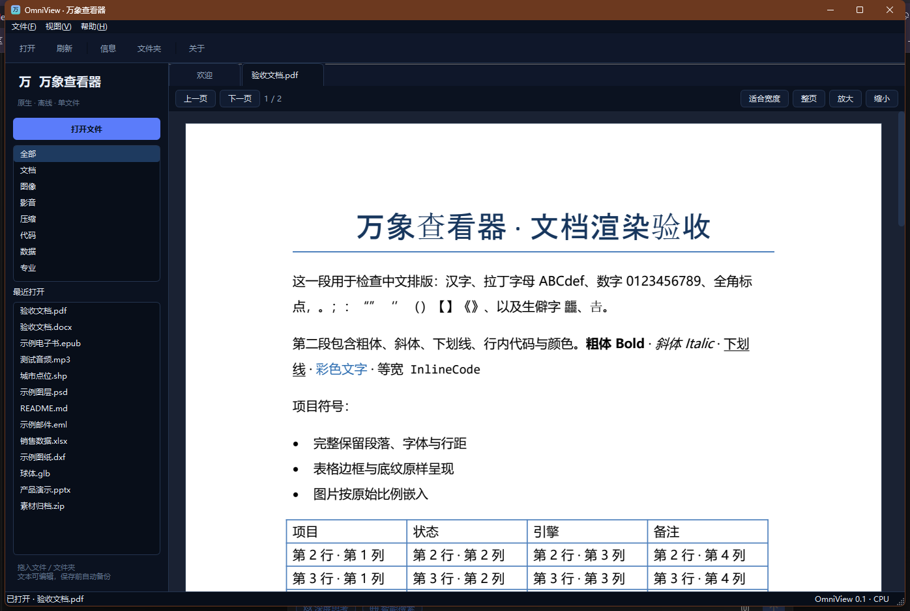
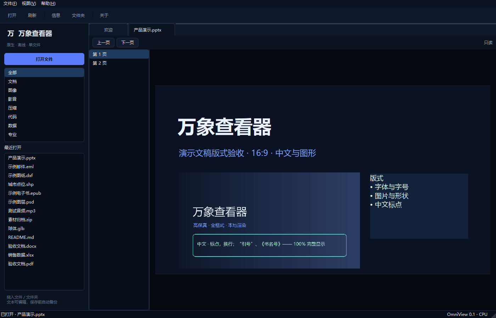
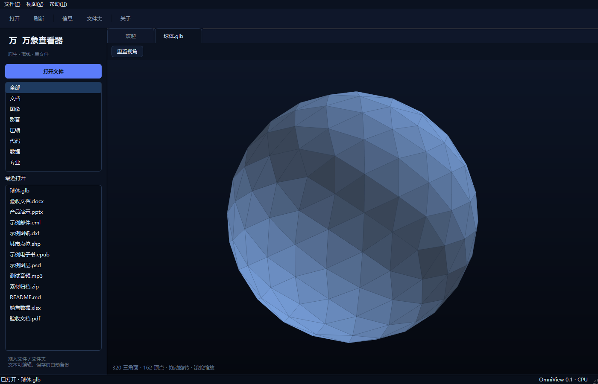

# OmniView

**English** | [简体中文](README.zh-CN.md)

A Windows file viewer built around one fairly ordinary annoyance: there is always some file on your machine — a PDF, a DOCX, an Excel sheet, a PSD, an archive, a video — and opening it means installing yet another suite of software first.

OmniView is my attempt to make that part simpler. One native window, a small core, and optional plugins for the formats that need more than the core can reasonably carry.

It is not a replacement for Office, Photoshop, or AutoCAD. It is a viewer: open the file, look at it, check the contents, move on. For real editing, use the tool that is actually good at editing.








---

## Download and install

The latest build is on the [Releases page](https://github.com/liyabl/-OmniView/releases/latest).

Download `OmniView-Setup.exe` and run it. It extracts the core to:

```text
%LOCALAPPDATA%\OmniView\0.3
```

and starts the app.

The first launch asks you to pick an interface language. Your files are always displayed in their original language; only the UI is translated.

### The core alone is enough for many people

The core handles PDF, plain text, code, images, audio/video, archives, and SQLite. If that is all you need, you can stop here.

### Add plugins only when you need them

The release also contains separate `.ovp` packages:

```text
office.ovp   DOCX / XLSX / PPTX / ODT / ODP / RTF
ebook.ovp    EPUB / MOBI / AZW3
data.ovp     Access / DBF / HDF5 / ONNX / PT / PKL / TFLite / mail stores
pro.ovp      STL / OBJ / GLB / DXF / SHP / KML / GPX / EXE / ELF / fonts
raw.ovp      PSD / AI / camera RAW
hello.ovp    a small example of a user-made plugin
```

The easiest path is to double-click `Install-All-Plugins.cmd`. It closes any running OmniView instance, installs the plugins next to it into:

```text
%LOCALAPPDATA%\OmniView\plugins\
```

and starts OmniView again.

You can also install one plugin at a time:

- Open a file that needs it and click **Install from .ovp file…**
- Or open **Help → Plugin Manager… → Install .ovp…**
- Or drag an `.ovp` file into the OmniView window

A few practical notes:

- Installing/updating closes the running OmniView. Save any edited text first.
- The build is not code-signed, so Windows SmartScreen may say “Unknown publisher”. Use **More info → Run anyway**.
- Do not install plugins you do not need.

---

## What it can do

The core does not rely on Office, WPS, Photoshop, AutoCAD, 7-Zip, or FFmpeg being installed on the machine.

- PDF: native PDFium rendering, page navigation, zoom, fit-to-width
- Text/code: encoding detection, syntax highlighting, editing for ordinary text files
- Images: PNG, JPEG, GIF, WebP, TIFF, BMP, ICO, SVG, and more
- Audio/video: decoding through Qt's bundled FFmpeg
- Archives: ZIP, 7Z, RAR, TAR, ISO, and others via a bundled 7-Zip
- SQLite: open a database and inspect tables and rows

Plugins add:

- Office documents: DOCX, ODT, RTF, XLSX, PPTX, ODP
- E-books: EPUB, MOBI, AZW3
- Data and models: Access, DBF, HDF5, ONNX, PT, PKL, TFLite
- 3D/CAD/GIS: STL, OBJ, GLB, DXF, SHP, KML, GPX
- RAW/PSD: camera RAW, Photoshop PSD, AI

**The honest part:**

- DOCX and PPTX are reflowed natively. They are not pixel-identical to Word or PowerPoint page layout.
- DWG currently exposes headers, version, and embedded strings. DXF is rendered properly.
- STEP, BLEND, SKP, and PST are structural/metadata views, not full professional kernels.
- Video seeking depends on the file's index. A damaged or index-less stream may only play sequentially.

---

## Why not one giant .exe?

The first version was a 105 MB single executable with everything inside.

It worked, but it had two problems:

1. every user paid the size cost for formats they never opened;
2. changing one dependency meant shipping the whole thing again.

The current version is split into three layers:

- **Core**: native window, PDF, text, images, audio/video, archives, SQLite
- **Plugins**: Office, e-books, data, 3D, RAW — independent packages
- **Setup**: a self-extracting launcher that unpacks the core on first run

The extracted core is about 186 MB; the setup is about 62 MB. Plugins range from roughly 1 MB to 25 MB, and you only install the ones you want.

---

## Large files

This is where most of the engineering time went.

### Text

Text files over 8 MB are no longer loaded into the editor as one string. OmniView uses `mmap` and decodes a window of roughly 2 MB at a time.

Previous/next chunk and percentage jumps are available. Only the current window lives in the editor.

A 30 MB log may hold 1–2 MB of characters in the widget; a 500 MB file does not become one giant Python string.

### Video

Playback uses Qt's `QMediaPlayer` as a stream. Nothing is transcoded and the whole video is not cached in memory.

Whether a very long video seeks well depends on the container and its index, not just the duration. A damaged stream without an index can only play in order.

### PDF

Only pages near the current viewport are rendered. The whole document is not rasterized on open.

### Archives

The listing comes from 7-Zip; an entry is extracted to cache only when you open it.

---

## Languages

The first launch asks which interface language you want.

The list includes the six UN official languages plus languages with more than 30 million speakers — 58 entries in total.

The translation status is uneven, and I would rather say so:

- Complete catalogs: `en / zh / fr / es / ru / ar`
- The rest currently fall back to English and are marked `English fallback` in the picker

Catalogs are plain JSON:

```text
omniview/locales/<code>.json
```

You can contribute through a PR, or drop a file into:

```text
%LOCALAPPDATA%\OmniView\locales\<code>.json
```

Only the interface is translated. File contents are never translated.

---

## Plugins and making your own

An `.ovp` is just a zip:

```text
myplugin.ovp
  plugin.json
  plugin.py          # optional custom viewer
  site-packages/     # optional dependencies
```

`plugin.json`:

```json
{
  "id": "hello",
  "name": "Hello Viewer",
  "version": "1.0.0",
  "formats": ["hello"],
  "entry": "plugin.py",
  "factory": "create_viewer"
}
```

`plugin.py` returns a `ViewerBase`:

```python
from omniview.ui.common import ViewerBase


class HelloViewer(ViewerBase):
    ...


def create_viewer(path, parent=None):
    return HelloViewer(path, parent)
```

A working template is in the repo:

```powershell
python build_ovp.py --template plugins/hello
python build_ovp.py --source plugins/hello --out plugins/hello.ovp
```

Install `hello.ovp`, then open a `.hello` file to see it in action.

The full format reference is in [docs/PLUGIN_FORMAT.md](docs/PLUGIN_FORMAT.md).

### When parsing fails

OmniView does not exit silently, and it does not just show a modal and forget about it.

It opens a red **Unable to parse this file** tab with:

- the file path
- the plugin id
- the full traceback
- Copy error
- Open Plugin Manager
- Open file location

If the plugin is missing, you get a separate page with the plugin size, an install button, and **Install from .ovp file…**.

---

## Run from source

```powershell
pip install -r requirements.txt
python app.py
```

The core does not need the plugin dependencies.

### Build the full release

```powershell
pip install -r requirements.txt -r plugin_requirements.txt -r dev-requirements.txt

python build_office_plugin.py
python build_plugins.py
.\build_core.ps1
.\build_setup.ps1
```

Output:

```text
release\OmniView-Setup.exe
plugins\*.ovp
```

Building the setup requires 7-Zip on the machine, or:

```powershell
$env:SEVENZIP = "C:\path\to\7z.exe"
```

Pushing a `v*` tag lets GitHub Actions build and publish the release.

---

## Uninstall

Run `packaging\Uninstall.cmd`, or delete:

```text
%LOCALAPPDATA%\OmniView\0.3
```

Plugins are kept by default in:

```text
%LOCALAPPDATA%\OmniView\plugins
```

Delete that directory too if you want a clean removal.

---

## Known limitations

- DOCX/PPTX will not match Office page-for-page.
- DWG is still a metadata view; full DWG needs a LibreDWG plugin.
- STEP/BLEND/SKP/PST are structural views.
- Video seek depends on the file index.
- Very large text is read-only chunked mode; it does not edit the original file in place.
- Plugins are not signed or sandboxed. `.ovp` files execute Python code; only install ones you trust.
- Plugin checksums, delta updates, and crash reporting are still on the list.

---

## License

- Core and original plugin code: **FSL-1.1-ALv2**, converting to Apache-2.0 after two years. Full text in [LICENSE](LICENSE).
- `ebook.ovp` contains GPL-3.0 `mobi`/KindleUnpack and GPL-2.0 `unidecode`; the plugin package as a whole is distributed under GPL-3.0-compatible terms.
- `data.ovp` contains GPL-3.0 `extract-msg` and `RTFDE`; the plugin package as a whole is distributed under GPL-3.0-compatible terms.
- `office.ovp`, `pro.ovp`, and `raw.ovp` use mostly MIT/BSD/Apache dependencies. Qt/PySide6 is LGPLv3; 7-Zip is LGPL.
- Full third-party notices and bundled plugin licenses: [THIRD_PARTY_NOTICES.md](THIRD_PARTY_NOTICES.md).

The FSL core and the GPL plugins are separate components. Do not describe the whole release as FSL or MIT.
